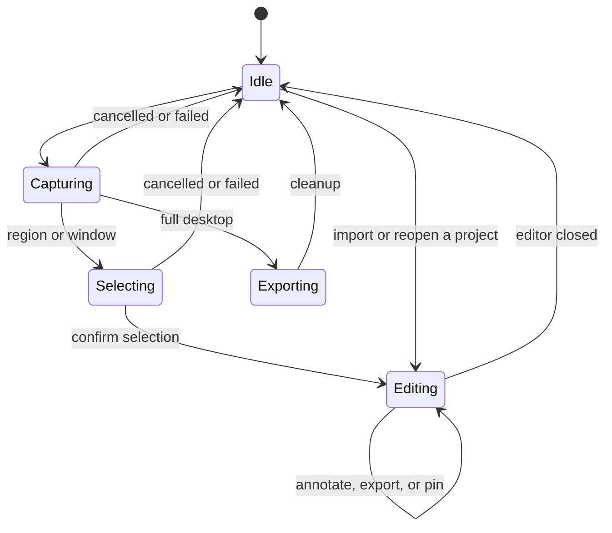

# Architecture

Tauri 2 owns the application lifecycle, WebView2 surfaces, tray, and integration with Windows shortcut registration and single-instance signaling. The dashboard is created on demand and released on close. The tray and shortcut service continue running without a WebView. The capture coordinator accepts one session at a time from the dashboard, tray, or global shortcuts.

The capture worker sets its thread to Per-Monitor V2 DPI awareness before invoking GDI or creating the overlay. The union of native monitor bounds defines one signed screen rectangle. The image origin is its top-left corner. Each source monitor is copied to that physical offset inside one top-down 32-bit DIB. Gaps between monitors are black. The overlay covers the same physical union and uses client pixel coordinates directly. DPI affects only the size of its controls. The editor translates pointer coordinates through the displayed-to-native canvas ratio.

| Source | Responsibility |
| --- | --- |
| `native/screen.rs` and `geometry.rs` | Monitor enumeration, physical transforms, screenshot allocation and GDI capture |
| `native/overlay.rs` | Native window and input, frozen bitmap paint, physical selection and dimensions |
| `session.rs` | Threaded capture lifecycle, overlap protection, cancellation and cleanup |
| `native/clipboard.rs` | Bounded retries, exact crop, bottom-up CF_DIB, Windows ownership and privacy marker |
| `editor.rs`, `Editor.tsx`, `editor-document.ts`, and `markup.ts` | In-memory crop transfer, editable document, native-resolution compositing and clipboard export |
| `export.rs`, `storage.rs`, and `pin.rs` | Scoped local export, project file lifecycle and the flattened pinned preview |
| `shortcuts.rs` and `settings.rs` | Windows registration, conflict handling, atomic settings replacement |
| `dashboard.rs`, `tray.rs` and `startup.rs` | Dashboard, tray and opt-in per-user startup |
| `diagnostics.rs` | Latest result and opt-in timing-only local log |

The native worker captures before creating the overlay. A second DIB supplies consistent dimmed pixels while the original supplies the active selection. After selection confirmation, the worker crops to opaque RGBA and drops both desktop DIBs. The editor capability reads the selected crop in memory and submits the finished result for clipboard, file export or pinning. Closing the editor clears the crop and releases the capture session. The dashboard has a separate capability for capture, shortcut controls and local History. The pinned window reads only its flattened preview.
