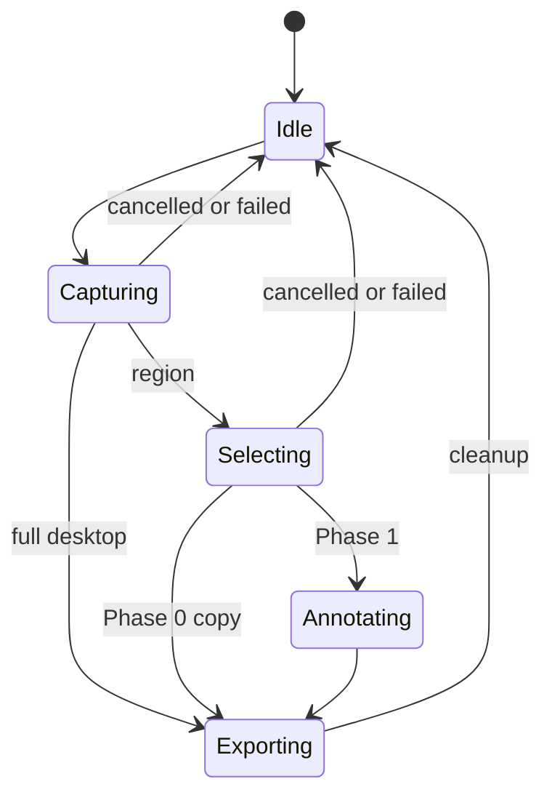

# Architecture

Tauri 2 owns the application lifecycle, dashboard WebView2 surface, tray, and integration with Windows shortcut registration and single-instance signaling. Rust owns capture and clipboard operations. The long-lived capture coordinator accepts one session at a time from any entry point.

Treat desktop origins as signed physical coordinates. Use a desktop bounds rectangle to transform between a screen pixel and its offset in the frame. If a future CSS canvas participates in capture, convert via the actual backing-size to viewport-size ratio per monitor.

Keep responsibility boundaries for native capture, window management, hotkeys, tray, lifecycle, clipboard, export, settings, storage, diagnostics, and annotations. Phase 0 implements the boundaries required for capture and keeps image export, storage, and annotation modules on the backlog. No screenshot data belongs in the webview, settings, or diagnostic records.
